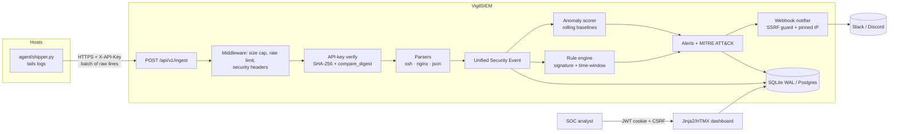

# VigilSIEM Architecture

## Data flow

## Trust boundaries
| Boundary | Credential | Controls |
|---|---|---|
| Agent → `/api/v1/ingest` | `X-API-Key` (hash at rest) | 120 req/min per key, 512 KB cap, strict schema, constant-time verify |
| Analyst → dashboard/API | JWT in `HttpOnly; Secure; SameSite=Strict` cookie | 5 login/min per IP, scrypt passwords, CSRF header on writes, short TTL |
| Server → webhooks | none (URL is the secret) | https/443 only, every resolved IP must be public, IP pinned, no redirects |
| Rules dir → engine | filesystem | `yaml.safe_load`, schema-validated, regex length/complexity limits |

## Key design decisions
- **Two auth planes** (API key vs. JWT) so a leaked agent key can never reach management routes.
- **Pure-ASGI middleware** (not `BaseHTTPMiddleware`) so the body cap also applies to streamed bodies.
- **Strict CSP, no CDN at runtime:** htmx, Alpine (CSP build) and precompiled Tailwind are vendored and served from `'self'`; this avoids `unsafe-inline`/`unsafe-eval`.
- **Fail-closed config:** missing/weak `VIGIL_JWT_SECRET` aborts startup.
- **DB portability:** only SQLAlchemy 2.0 constructs; swap `VIGIL_DATABASE_URL` for Postgres. SQLite runs WAL + `foreign_keys=ON`.
- **Rate limiter** is per-process in-memory (sliding window, LRU-bounded). Multi-replica deployments need a shared store (documented limitation).

## OWASP API Security Top 10 (2023) mapping
| Risk | Mitigation |
|---|---|
| API1 BOLA | Single-tenant admin plane; alert IDs only reachable post-auth |
| API2 Broken Auth | scrypt, JWT alg pinned + required claims, login throttling, generic auth errors |
| API3 Property-level authz | `extra="forbid"` request models; explicit response models |
| API4 Resource consumption | Body cap, batch/line/field bounds, rate limits, bounded in-memory structures |
| API5 Function-level authz | Separate dependencies for ingest vs. admin; CSRF on writes |
| API6 Sensitive flows | Login + key issuance throttled; plaintext keys shown once |
| API7 SSRF | `security/ssrf.py` |
| API8 Misconfiguration | Security headers, sanitized errors, non-root read-only container, no defaults for secrets |
| API9 Inventory | Versioned `/api/v1`, OpenAPI docs disabled in production |
| API10 Unsafe consumption | Webhook responses ignored/size-capped; no redirects followed; logs treated as untrusted input |

## Threat notes
- **Log injection / forged lines:** raw logs are stored as data, rendered with Jinja2 autoescape; control chars stripped before display.
- **ReDoS:** rule regexes are length-capped and matched against length-capped fields.
- **Alert flooding:** correlation rules de-duplicate per (rule, key, window).
