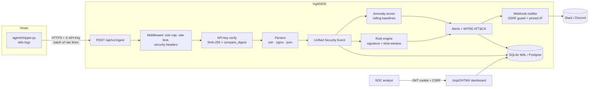

# VigilSIEM

[](https://github.com/efe-gucluturk/vigilsiem/actions/workflows/ci.yml)


**A secure-by-design mini-SIEM and log anomaly detection engine.** VigilSIEM ingests logs from
lightweight agents, parses and normalizes them into a unified event model, detects threats with
declarative YAML rules and rolling anomaly baselines, and surfaces alerts (mapped to MITRE ATT&CK)
in a SOC dashboard and via SSRF-safe webhooks.

## Key capabilities

- **Ingest** – authenticated batch API (`POST /api/v1/ingest`) plus a tailing agent (`agent/shipper.py`).
- **Parse & normalize** – SSH auth, nginx access and JSON application logs into one security event schema.
- **Detect** – YAML signature rules, time-window correlation (brute force, password spraying, error floods)
  and rolling-baseline anomaly scoring. Rules are data, never code.
- **Alert** – de-duplicated per (rule, key, window), tagged with MITRE ATT&CK techniques.
- **Respond** – SOC dashboard (Jinja2 + HTMX + Alpine) and Slack/Discord webhooks.
- **Validate** – attack simulator (SSH brute force, spraying, SQLi, XSS, traversal, scanners, sudo abuse, anomalies).

## Tech stack

Python 3.12 · FastAPI · Pydantic v2 (strict) · SQLAlchemy 2.0 async (SQLite WAL / PostgreSQL) ·
PyJWT · Jinja2 · HTMX · Alpine.js (CSP build) · pytest · ruff (+ flake8-bandit) · bandit · Docker · GitHub Actions.

## Architecture



More detail, trust boundaries and threat notes: [ARCHITECTURE.md](ARCHITECTURE.md).

## Security hardening & OWASP API Top 10 (2023)

| Control | Implementation | OWASP |
|---|---|---|
| **Auth plane separation** | Ingest accepts `X-API-Key` only; admin uses a JWT (HS256 pinned) in an `HttpOnly; Secure; SameSite=Strict` cookie. A leaked agent key can never reach management routes. | API2, API5 |
| **Timing-safe API keys** | Only the SHA-256 is stored; verified with `secrets.compare_digest`; unknown prefixes still run a dummy compare. | API2 |
| **SSRF defence** | Webhook URLs must be https/443, every resolved IP must be public, the connection is **pinned to the validated IP** (defeats DNS rebinding), redirects are not followed, responses are size-capped. | API7, API10 |
| **512 KB streaming body cap** | Pure-ASGI middleware counts bytes as they stream, so chunked bodies can't bypass it (HTTP 413). Batch/line/field bounds on top. | API4 |
| **Sliding-window rate limits** | 120 req/min per API key (ingest), 5/min per IP (login), 600/min per session (admin); LRU-bounded memory. | API4, API6 |
| **CSRF** | Signed token in a header required on every POST/PUT/PATCH/DELETE. | API5 |
| **Strict CSP** | `script-src 'self'`; htmx, Alpine (CSP build) and compiled Tailwind are vendored; no inline scripts/styles, no CDN. | API8 |
| **Strict schemas** | `extra="forbid"`, max lengths on every string, `IPvAnyAddress`, enums for closed sets. | API3 |
| **Safe errors** | Clients only see `{"error":{"code","message"}}`; details go to the redacted JSON log. | API8 |
| **No dangerous primitives** | No `eval/exec/pickle/shell=True`, `yaml.safe_load` only, bound-parameter SQL via the ORM, ReDoS-guarded rule regexes. | API8 |
| **Fail-closed config** | No default `VIGIL_JWT_SECRET`; weak or missing secrets abort startup. | API8 |
| **Hardened container** | Multi-stage build, non-root UID 10001, read-only FS, all caps dropped, `no-new-privileges`, `--no-server-header`. | API8 |

SAST (`bandit`, ruff `S` rules) and adversarial tests (auth bypass, SQLi, oversize, rate limit, SSRF, CSRF)
run on every push.

## Quickstart

```bash
git clone https://github.com/efe-gucluturk/vigilsiem.git && cd vigilsiem
python -m venv .venv && . .venv/bin/activate        # Windows: . .venv/Scripts/activate
pip install -e ".[dev]"

# 1. Configure secrets
cp .env.example .env
python -c "import secrets; print(secrets.token_urlsafe(48))"   # -> VIGIL_JWT_SECRET in .env
python scripts/manage_admin.py hash                            # -> VIGIL_ADMIN_PASSWORD_HASH in .env

# 2. Mint an agent API key (shown once; only its SHA-256 is stored)
python scripts/manage_keys.py create --name web-01

# 3. Start the server (VIGIL_COOKIE_SECURE=false only for local plain-http dev)
set -a; . ./.env; set +a
VIGIL_COOKIE_SECURE=false uvicorn --factory vigilsiem.api.app:create_app --no-server-header

# 4. In another shell: fire simulated attacks and verify the alerts
export VIGIL_AGENT_API_KEY=vsk_...                  # key from step 2
export VIGIL_ADMIN_USER=admin VIGIL_ADMIN_PASSWORD=...
python scripts/simulate_attacks.py --server http://127.0.0.1:8000 --verify
```

Open http://127.0.0.1:8000 and sign in as the admin to see the alerts.

Other simulator modes: `--self-check` (offline, in-process parsers + rules) and `--output-dir logs/`
(generate log files to tail with `python agent/shipper.py --help`).

### Docker

```bash
cp .env.example .env   # fill in secrets
docker compose up --build   # binds 127.0.0.1:8000; put a TLS reverse proxy in front
```

### Development

```bash
ruff check .            # lint (includes bandit "S" rules)
bandit -r src/ -c pyproject.toml
pytest
```

## Repository structure

```text
.
├── src/vigilsiem/
│   ├── core/        config, logging (redaction), db, errors, ingestion, notifier
│   ├── models/      ORM, strict Pydantic schemas, enums
│   ├── security/    apikeys, passwords, tokens/CSRF, ratelimit, middleware, ssrf
│   ├── parsers/     ssh, nginx, json_app, normalizer
│   ├── engine/      rules, matchers, correlation, anomaly, regex_guard, pipeline
│   ├── api/         ingest, auth, admin, deps, app factory
│   └── web/         Jinja2 templates + vendored static assets
├── rules/           declarative YAML detection rules
├── agent/           shipper.py log-tailing agent
├── scripts/         manage_keys, manage_admin, simulate_attacks
├── tests/           unit, functional detection, adversarial API tests
├── Dockerfile  docker-compose.yml  .github/workflows/ci.yml
└── ARCHITECTURE.md  CLAUDE.md
```

## Authorized & Educational Use Only / Yalnızca Yetkili ve Eğitim Amaçlı Kullanım

VigilSIEM is a defensive monitoring tool intended for systems you own or are explicitly
authorized to monitor, and for education and portfolio/lab use. The attack simulator
(`scripts/simulate_attacks.py`) generates synthetic log lines (offline by default, or posted only
to the VigilSIEM server you specify with `--server`). It does not scan or probe hosts. Do not use this project to monitor
or test systems without authorization.

**Yalnızca Yetkili ve Eğitim Amaçlı Kullanım.** Bu proje yalnızca sahibi olduğunuz veya açık yazılı izin aldığınız sistemlerde ve eğitim amacıyla kullanılmalıdır. İzinsiz kullanım 5237 sayılı Türk Ceza Kanunu m. 243–244 kapsamında suç oluşturabilir; yazar kötüye kullanımdan sorumlu tutulamaz.

## License

MIT License. Copyright (c) 2026 Efe Güçlütürk. See [LICENSE](LICENSE).
